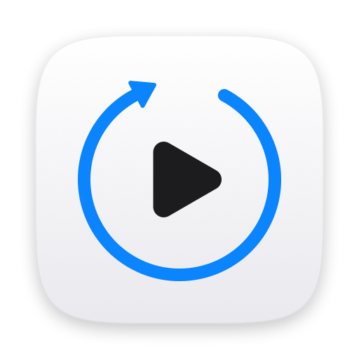

<p align="center">
  
</p>

<h1 align="center">SkipPlayer</h1>

<p align="center">A minimal macOS video player that skips 5 seconds with the arrow keys.</p>

QuickTime Player has no key for jumping a few seconds back or forward. SkipPlayer keeps the same simple,
document-based design (one window per video, built on AVKit's `AVPlayerView`) and adds the keyboard
shortcuts people expect from YouTube or VLC.

## Download

**[⬇ Download SkipPlayer.dmg](https://github.com/Jaygmin/SkipPlayer/releases/latest/download/SkipPlayer.dmg)**
— macOS 14 or later, Apple Silicon and Intel

1. Open `SkipPlayer.dmg` and drag **SkipPlayer** onto the **Applications** folder.
2. Open SkipPlayer from Applications.

SkipPlayer is not yet notarized by Apple, so macOS blocks it the first time you open it:

- **macOS 15 or later:** open SkipPlayer once and click **Done** in the warning. Then go to
  **System Settings → Privacy & Security**, scroll down and click **Open Anyway** next to
  "SkipPlayer was blocked".
- **macOS 14:** Control-click SkipPlayer in Applications, choose **Open**, then click **Open**.

You only need to do this once. To confirm that a download was built from this repository by its
release workflow, run:

```sh
gh attestation verify SkipPlayer.dmg --repo Jaygmin/SkipPlayer
```

## Keyboard shortcuts

| Key | Action |
|---|---|
| ← / → | Skip back / forward 5 seconds (stops at the start and end) |
| ↑ / ↓ | Volume up / down by 10% |
| Space | Play / pause (restarts from the beginning when at the end) |
| ⌃⌘F or 🌐F | Enter / exit full screen |
| ⌘O | Open a video |
| ⌘W | Close the window |

Holding an arrow key keeps skipping. Repeated presses add up even while a seek is still in progress.

## Build from source

Requirements: macOS 14 (Sonoma) or later and Swift 5.9 or later. Xcode is not required; the
Command Line Tools are enough (`xcode-select --install`).

```sh
git clone https://github.com/Jaygmin/SkipPlayer.git
cd SkipPlayer
./build-app.sh
open SkipPlayer.app
```

`build-app.sh` builds a Universal (Apple Silicon and Intel) release binary with SwiftPM, assembles
`SkipPlayer.app` and signs it locally (ad-hoc). To open a file directly, run
`open -a "$PWD/SkipPlayer.app" movie.mp4`. `./make-dmg.sh` also packs the app into `SkipPlayer.dmg`.

## Releases

Pushing a version tag (for example `git tag v1.0.0 && git push origin v1.0.0`) runs the
[release workflow](.github/workflows/release.yml) on GitHub Actions. It builds `SkipPlayer.dmg`,
signs a build provenance attestation for it, and publishes it as a GitHub Release.

## Security

- The app runs in the **App Sandbox** with a single entitlement:
  `com.apple.security.files.user-selected.read-only`. It can only read files you open, and it has no
  network, camera or microphone access.
- It is signed with the **Hardened Runtime** enabled.
- It has no third-party dependencies.
- Release DMGs are built on GitHub Actions from the tagged commit. Each comes with a signed
  [build provenance attestation](https://docs.github.com/en/actions/security-guides/using-artifact-attestations-to-establish-provenance-for-builds)
  that you can check with `gh attestation verify`.

## Project layout

```
Sources/SkipPlayer/
  main.swift                    App delegate and menu bar
  PlayerDocument.swift          One NSDocument per video, owns the AVPlayer
  PlayerWindowController.swift  Player window and keyboard handling
Info.plist                      Bundle metadata and supported file types
SkipPlayer.entitlements         Sandbox entitlements
build-app.sh                    Build, bundle and sign
make-dmg.sh                     Pack SkipPlayer.app into a drag-to-install SkipPlayer.dmg
.github/workflows/release.yml   Build, attest and publish a release for each version tag
scripts/make-icon.swift         Regenerates Resources/AppIcon.icns and docs/icon.png
```

## License

[MIT](LICENSE) © 2026 Jay Min
